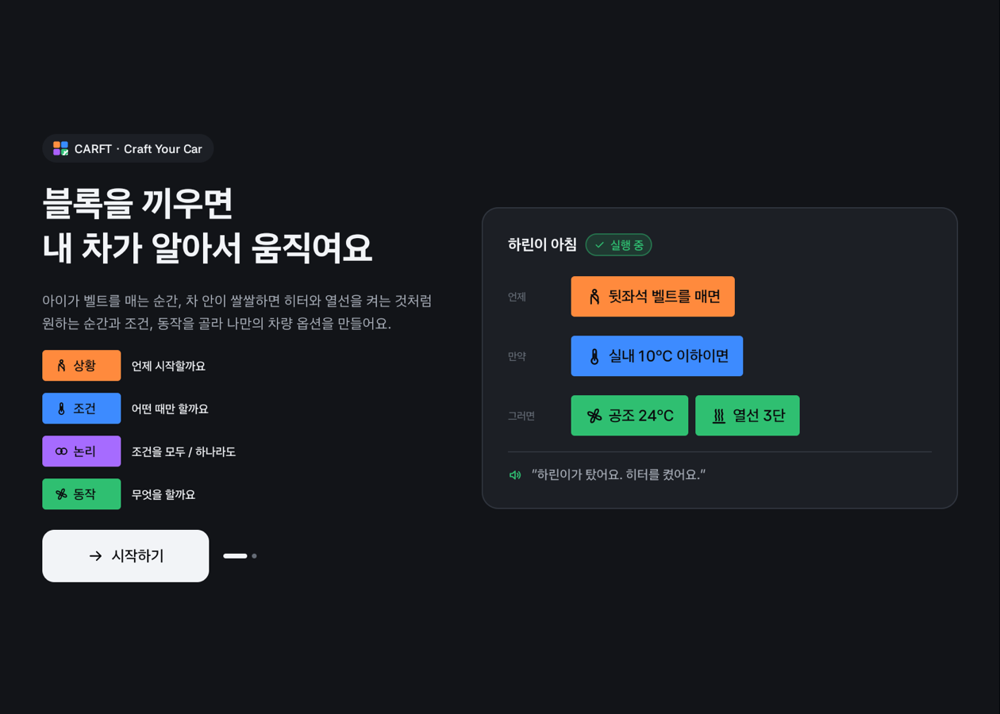
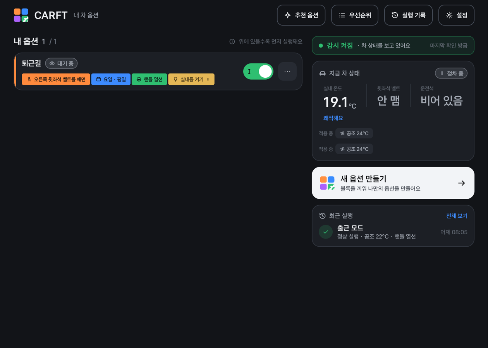

<p align="center">
  
</p>

<h1 align="center">CARFT</h1>

<p align="center"><b>타는 순간, 내 차가 나를 알아봐요</b></p>

<p align="center">
아이가 뒷좌석에서 벨트를 매면 히터와 열선이 켜지고, 비가 오기 시작하면 안내 음성이 흘러나와요.<br/>
CARFT는 이런 나만의 차량 옵션을 블록 몇 개로 직접 만들 수 있게 해 주는 Pleos Connect 앱이에요.
</p>

<p align="center">
  
</p>

| 앱 이름 | 팀명 | APK | 개발 에뮬레이터 |
| --- | --- | --- | --- |
| CARFT | 경고등 | [`apk/경고등_CARFT_release.apk`](apk/경고등_CARFT_release.apk) | Pleos Connect Emulator v2.1.0 (2560 × 1440) |

<br/>

## 1. 실행 방법

### APK로 바로 실행하기

Pleos Connect Emulator를 켠 뒤 아래 명령으로 설치하고 실행하면 돼요.

```bash
adb install -r apk/경고등_CARFT_release.apk
adb shell am start -n com.carft/.MainActivity
```

런처 앱 목록에서 **CARFT** 아이콘을 눌러 실행해도 괜찮아요. 처음 실행하면 짧은 소개 화면 두 장이 나오고, 그다음에 샘플 옵션 세 개가 들어 있는 홈 화면으로 이어져요.

### 소스에서 직접 빌드하기

```bash
git clone https://github.com/Joo-daeng/CARFT.git
cd CARFT
./gradlew :app:assembleRelease    # app/build/outputs/apk/release/app-release.apk 생성
./gradlew :app:installDebug       # 켜져 있는 에뮬레이터에 debug 버전 설치
```

JDK 17과 Gradle 8.13, Kotlin 1.9.10 환경에서 빌드했어요. Pleos SDK는 Pleos Playground 저장소(`nexus-playground.pleos.ai`)에서 자동으로 받아 오도록 `settings.gradle.kts`에 등록해 두었어요. release 빌드는 따로 서명 키를 준비하지 않아도 설치할 수 있도록 debug 키로 서명했어요.

<br/>

## 2. 테스트 환경 및 필요한 설정

| 항목 | 내용 |
| --- | --- |
| 개발 환경 | macOS, Android Studio, JDK 17 |
| 사용한 SDK | Pleos Playground `Vehicle 2.3.2`, `TextToSpeech 3.3.1` |
| 권한 | 좌석, 공조, 조명, 창문, 음성 안내 권한(`pleos.car.permission.*`)을 사용해요. 설치하면 별도로 허용하지 않아도 바로 동작해요 |

### Virtual Console로 차량 상태 바꿔 보기

CARFT의 옵션은 차량 상태가 바뀌는 순간 실행돼요. 에뮬레이터에 들어 있는 Virtual Console을 열면 좌석이나 와이퍼 같은 상태를 직접 바꿔 볼 수 있어요.

```bash
adb forward tcp:8088 tcp:8088
# 그다음 브라우저에서 http://127.0.0.1:8088/ 을 열어 주세요
```

운전석에 사람이 앉거나 와이퍼가 켜지도록 바꾸면, 앱이 그 변화를 받아 해당 옵션을 실행해요. 실행 결과는 홈 화면의 "최근 실행"과 "적용 중" 표시, 실행 기록 화면, 그리고 음성 안내로 확인할 수 있어요. 벨트나 실내 온도처럼 Virtual Console에 없는 항목은 앱 안의 **가상 테스트**에서 값을 정해 미리 돌려 볼 수 있어요.

### 2분 만에 둘러보기

1. 홈에서 **새 옵션 만들기**를 눌러요
2. 상황 탭에서 **좌석에 앉으면**을 고르고, 좌석 배치도에서 운전석을 선택해요
3. 조건 탭에서 **실내 온도**와 **요일**을 차례로 넣어요. 조건이 두 개가 되면 "그리고"와 "또는" 중 어떻게 묶을지 물어봐요
4. 동작 탭에서 **공조**, **운전석 열선**, **실내등 켜기**를 넣어 보세요. 실내등처럼 정차 중에만 할 수 있는 동작은 따로 안내해 줘요
5. **저장 및 검증**을 누르고 이름을 정하면, 다른 옵션과 부딪히지 않는지 확인한 뒤 저장할 수 있어요
6. Virtual Console에서 운전석 착좌를 바꾸면 방금 만든 옵션이 실행되고 실행 기록에 남아요

<br/>

## 3. 개발에 사용한 에뮬레이터 버전과 화면 규격

| 항목 | 내용 |
| --- | --- |
| 에뮬레이터 | **Pleos Connect Emulator v2.1.0** (AVD 이름 `Pleos_Connect_v2_1_0`) |
| OS | Android 14 (API 34), arm64-v8a |
| 화면 규격 | **2560 × 1440, 160dpi** (왼쪽 차량 패널을 제외한 앱 영역은 약 1706 × 1300) |

<br/>

## 4. APK 파일 위치

저장소의 [`apk/경고등_CARFT_release.apk`](apk/경고등_CARFT_release.apk)에 release 빌드를 올려 두었어요. 용량은 약 60MB이고, 패키지 이름은 `com.carft`, 버전은 1.0이에요.

<br/>

## 5. CARFT를 소개할게요

차 안의 공조, 열선, 조명은 저마다 다른 메뉴에 흩어져 있어서 "추운 아침 출발" 같은 상황 하나에도 여러 화면을 오가야 해요. 매일 같은 조작을 반복하면서도 자동으로 맡길 방법은 마땅치 않았고요.

CARFT에서는 **언제**(상황), **만약**(조건), **그러면**(동작) 블록을 이어 붙이기만 하면 그 조합이 하나의 옵션이 돼요. 그다음부터는 차가 상황을 알아차리는 순간 알아서 실행해 줘요.

- **조립판** 블록을 끼우면 오른쪽에 "이렇게 동작해요" 문장이 바로 만들어져서, 내가 만든 규칙을 말로 확인할 수 있어요
- **저장 전 검증** 조건끼리 서로 막지는 않는지, 다른 옵션과 같은 동작을 두고 부딪히지는 않는지 저장하기 전에 알려 줘요
- **자동 실행과 기록** 상황이 생기면 실행하고, 무엇이 왜 실행됐는지 기록으로 남겨 줘요
- **주행 중 안전** 정차 중에만 해야 하는 동작은 차가 멈춘 뒤에 실행해요

| 홈 | 조립판 |
| --- | --- |
|  |  |
| **블록 설정** | **저장 전 검증** |
|  |  |

<br/>

---

## 참고 자료

<details>
<summary><b>블록 종류</b></summary>

| 종류 | 블록 |
| --- | --- |
| 상황 (언제) | 벨트를 매면, 좌석에 앉으면, 와이퍼가 켜지면, 정한 시각이 되면 |
| 조건 (만약) | 실내 온도, 요일, 시간대, 와이퍼 꺼짐 |
| 동작 (그러면) | 공조, 운전석 열선, 핸들 열선, 음성 안내, 실내등 켜기(정차 중), 내비 목적지(정차 중) |

</details>

<details>
<summary><b>Pleos SDK를 어디에 썼는지</b></summary>

| 차량 데이터와 기능 | Pleos Vehicle SDK | 앱에서 쓰는 곳 |
| --- | --- | --- |
| 좌석 착좌, 안전벨트 | `getSeat()` | 상황 "좌석에 앉으면", "벨트를 매면"과 홈 차 상태 |
| 실내 온도 | `getHVAC().registerHvacTemperatureCurrent` | 조건 "실내 온도"와 홈 차 상태 |
| 와이퍼 | `getWiper().registerWiperState` | 상황 "와이퍼가 켜지면", 조건 "와이퍼 꺼짐" |
| 공조 설정 온도 | `getHVAC()` 설정과 `registerHvacTemperature` 구독 | 동작 "공조"와 홈 "적용 중" 표시 |
| 좌석 열선, 핸들 열선 | `getSeat()`, `getSteeringWheel()` | 동작 "운전석 열선", "핸들 열선" |
| 실내등 | `getLight()` | 동작 "실내등 켜기" |
| 음성 안내 | `TextToSpeech` | 동작 "음성 안내"와 실행 알림 |

</details>

<details>
<summary><b>에뮬레이터에서 확인할 때 알아 두면 좋은 점</b></summary>

- 에뮬레이터 2.1.0의 착좌 값 표기에 맞춰 앱에서 값을 읽도록 맞춰 두었어요 (`PleosVehicle.SDK_OCCUPANCY_INVERTED`)
- 공조 설정 온도는 구독으로 받은 값을 보고 반영됐는지 확인해요
- "내비 목적지" 동작은 지금 SDK 버전에서 제공되는 API가 없어 실행 기록에 미지원으로 표시돼요
- 정한 시각, 요일, 시간대 블록은 기기 시계를 기준으로 동작해요

</details>

<details>
<summary><b>프로젝트 구조</b></summary>

```
app/src/main/kotlin/com/carft/
├── app/             # 의존성 구성과 화면 이동
├── domain/          # 블록과 규칙 모델, 조건 판단, 검증
├── runtime/         # 상황 감지 → 조건 확인 → 동작 실행
├── infrastructure/  # Pleos SDK 연결
├── data/            # 옵션과 설정 저장, 추천 템플릿
└── feature/         # 화면별 ViewModel과 Compose UI
core/designsystem/   # 색, 글꼴, 아이콘, 공용 컴포넌트
```

</details>
