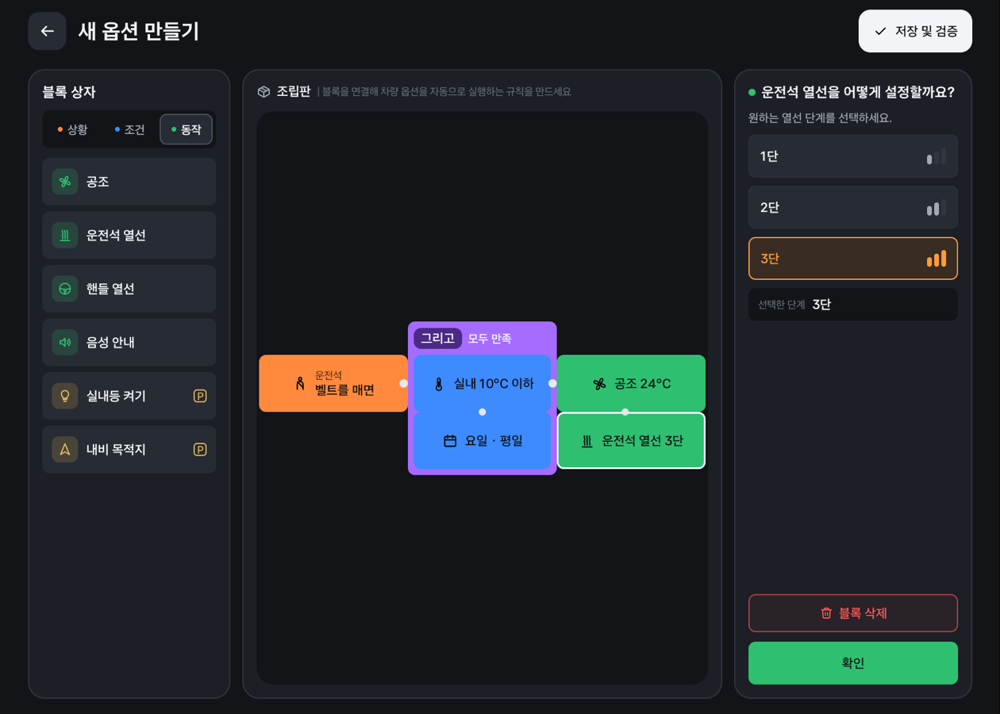
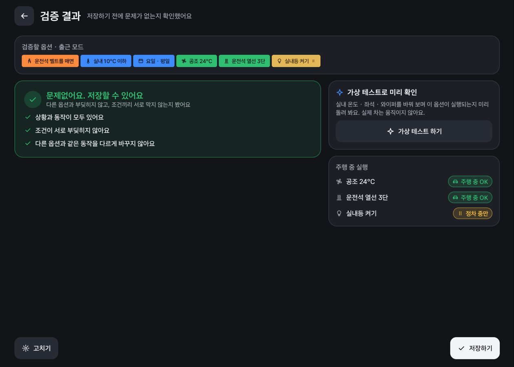

# CARFT

**내 자동차의 옵션을, 내가 만든다.**
차의 상황·조건·동작을 블록처럼 조립해 나만의 차량 옵션을 만드는 Pleos Connect 노코드 자동화 앱입니다.

| 항목 | 내용 |
| --- | --- |
| 앱 이름 | CARFT |
| 팀명 | 경고등 |
| APK | [`apk/경고등_CARFT_release.apk`](apk/경고등_CARFT_release.apk) |
| 에뮬레이터 | Pleos Connect Emulator v2.1.0 · 2560 × 1440 |

## 1. 실행 방법

### APK로 실행

```bash
# Pleos Connect Emulator가 켜진 상태에서
adb install -r apk/경고등_CARFT_release.apk
adb shell am start -n com.carft/.MainActivity
```

런처 앱 목록에서 **CARFT**를 눌러 실행해도 됩니다. 처음 실행하면 온보딩 뒤 샘플 옵션 3개가 든 홈으로 들어갑니다.

### 소스에서 빌드

```bash
git clone https://github.com/Joo-daeng/CARFT.git
cd CARFT
./gradlew :app:assembleRelease      # app/build/outputs/apk/release/app-release.apk
./gradlew :app:installDebug         # 에뮬레이터에 debug 설치
```

- JDK 17, Android Gradle Plugin 8.13, Gradle 8.13, Kotlin 1.9.10
- Pleos SDK는 `https://nexus-playground.pleos.ai/repository/maven-releases/`에서 받습니다 (`settings.gradle.kts`에 등록됨)
- release 빌드는 별도 키 없이 설치할 수 있도록 debug 키로 서명합니다

## 2. 테스트 환경 및 필요한 설정

| 항목 | 값 |
| --- | --- |
| 개발 환경 | macOS, Android Studio, JDK 17 |
| 사용 SDK | Pleos Playground `Vehicle 2.3.2`, `TextToSpeech 3.3.1` |
| 권한 | `pleos.car.permission.*` (좌석·공조·조명·창문·TTS) — 설치 후 별도 허용 절차 없이 동작 |

### 차량 상태 바꿔 보기 (Virtual Console)

옵션은 차량 상태가 바뀌는 순간 실행됩니다. 에뮬레이터의 Virtual Console로 상태를 바꿔 확인합니다.

```bash
adb forward tcp:8088 tcp:8088
# 브라우저에서 http://127.0.0.1:8088/ 열기
```

- 운전석 착좌, 와이퍼, 공조 온도 등을 바꾸면 앱이 이를 받아 해당 옵션을 실행합니다
- 결과는 홈 "최근 실행"·"적용 중", **실행 기록** 화면, 음성 안내로 확인합니다

### 시연 순서 (약 2분)

1. 홈에서 **새 옵션 만들기**
2. 상황 **좌석에 앉으면** → 운전석 선택 → 확인
3. 조건 **실내 온도가 ○°C** → **요일**(평일) → 그리고/또는에서 그리고 → 확인
4. 동작 **공조**(24°C) → **운전석 열선**(3단) → **실내등 켜기**
5. **저장 및 검증** → 이름 → 검증 결과 확인 → 저장
6. Virtual Console에서 운전석 착좌를 바꾸면 옵션이 실행되고 실행 기록에 결과가 남습니다

## 3. 에뮬레이터 버전과 화면 규격

| 항목 | 값 |
| --- | --- |
| 에뮬레이터 | **Pleos Connect Emulator v2.1.0** (AVD `Pleos_Connect_v2_1_0`) |
| OS | Android 14 / API 34, arm64-v8a |
| 화면 규격 | **2560 × 1440, 160dpi** (앱 영역은 왼쪽 차량 패널을 뺀 약 1706 × 1300) |

## 4. APK 파일 위치

- 저장소 [`apk/경고등_CARFT_release.apk`](apk/경고등_CARFT_release.apk) (release 빌드, 약 60MB)
- 패키지 `com.carft`, 버전 `1.0`

## 5. 서비스 소개

공조·열선·조명은 메뉴마다 흩어져 있어, "추운 아침 출발" 같은 한 상황에도 여러 번 조작해야 합니다. CARFT는 **언제(상황) · 만약(조건) · 그러면(동작)** 블록을 이어 붙여 이 조합을 옵션 하나로 만들고, 차가 상황을 감지하면 알아서 실행합니다.

- **조립판**: 블록을 이어 붙이면 오른쪽에 "이렇게 동작해요" 문장이 바로 만들어집니다
- **저장 전 검증**: 조건끼리의 모순, 다른 옵션과의 충돌, 주행 중 실행 가능 여부를 미리 알려 줍니다
- **자동 실행과 기록**: 상황이 생기면 실행하고, 무엇이 왜 실행됐는지 기록으로 남깁니다
- **주행 중 안전**: 정차 전용 동작은 차가 멈춘 뒤 실행합니다

| 홈 | 조립판 |
| --- | --- |
|  |  |
| **블록 설정** | **저장 전 검증** |
|  |  |

---

## 참고

### 블록 종류

| 종류 | 블록 |
| --- | --- |
| 상황 (언제) | 벨트를 매면 · 좌석에 앉으면 · 와이퍼가 켜지면 · 정한 시각이 되면 |
| 조건 (만약) | 실내 온도 · 요일 · 시간대 · 와이퍼 꺼짐 |
| 동작 (그러면) | 공조 · 운전석 열선 · 핸들 열선 · 음성 안내 · 실내등 켜기(정차 전용) · 내비 목적지(정차 전용) |

### Pleos SDK 활용

| 차량 데이터·기능 | Pleos Vehicle SDK | 쓰는 곳 |
| --- | --- | --- |
| 좌석 착좌·안전벨트 | `getSeat()` | 상황 "좌석에 앉으면"·"벨트를 매면", 홈 차 상태 |
| 실내 온도 | `getHVAC().registerHvacTemperatureCurrent` | 조건 "실내 온도", 홈 차 상태 |
| 와이퍼 | `getWiper().registerWiperState` | 상황 "와이퍼가 켜지면", 조건 "와이퍼 꺼짐" |
| 공조 설정 온도 | `getHVAC()` 설정 · `registerHvacTemperature` | 동작 "공조", 홈 "적용 중" |
| 좌석·핸들 열선 | `getSeat()`, `getSteeringWheel()` | 동작 "운전석 열선"·"핸들 열선" |
| 실내등 | `getLight()` | 동작 "실내등 켜기" |
| 음성 안내 | `TextToSpeech` | 동작 "음성 안내", 실행 알림 |

### 에뮬레이터 환경에서 참고할 점

- 에뮬레이터 2.1.0의 착좌 값 표기에 맞춰 앱에서 값을 맞춰 읽습니다 (`PleosVehicle.SDK_OCCUPANCY_INVERTED`)
- 공조 설정 온도는 구독 값으로 반영 여부를 확인합니다
- "내비 목적지" 동작은 현재 SDK 버전에서 제공되는 API가 없어 실행 기록에 미지원으로 표시됩니다
- 벨트·실내 온도처럼 Virtual Console에 없는 항목은 앱의 **가상 테스트**로 확인할 수 있습니다
- 정한 시각·요일·시간대 블록은 기기 시계를 기준으로 합니다

### 프로젝트 구조

```
app/src/main/kotlin/com/carft/
├── app/             # 의존성 구성, 내비게이션
├── domain/          # 블록·규칙 모델, 조건 평가, 검증
├── runtime/         # 상황 감지 → 조건 → 동작 실행
├── infrastructure/  # Pleos SDK 어댑터
├── data/            # 옵션·설정 저장, 추천 템플릿
└── feature/         # 화면별 ViewModel + Compose
core/designsystem/   # 색·타이포·아이콘·공용 컴포넌트
```
