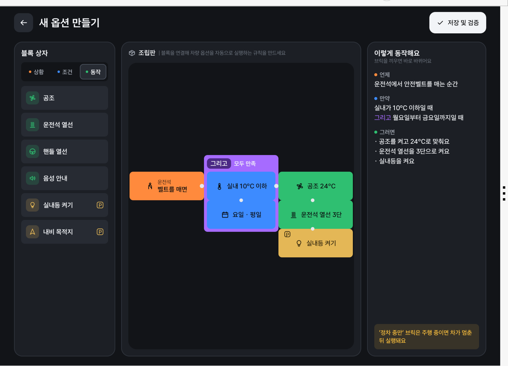
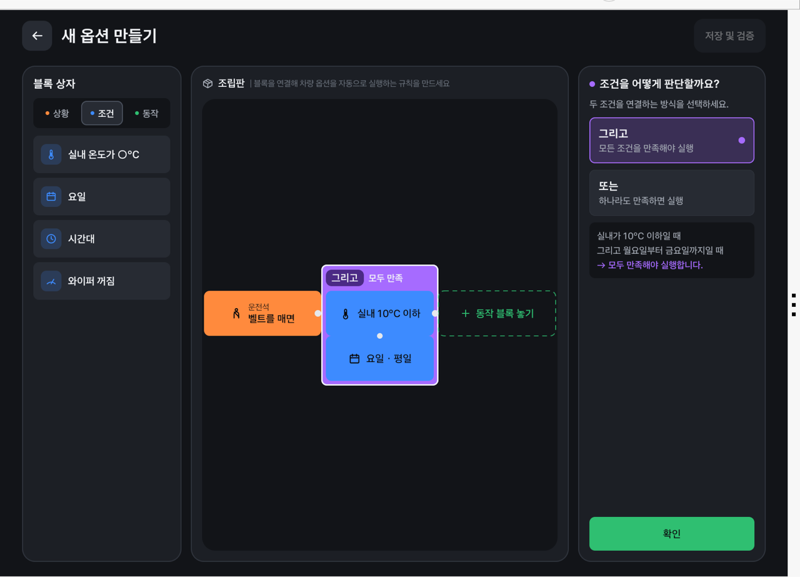

# CARFT

> **내 자동차의 옵션을, 내가 만든다.**
> 차만 아는 신호(착좌·벨트·실내 온도·와이퍼·시각)와 차만 바꿀 수 있는 기능(공조·열선·실내등·음성)을 블록처럼 조립해, 매일 반복하던 조작을 나만의 차량 옵션 하나로 만드는 Pleos Connect 노코드 자동화 앱입니다.

| 항목 | 내용 |
| --- | --- |
| 앱 이름 | CARFT (Car + Craft) |
| 팀명 | 경고등 |
| 플랫폼 | Pleos Connect (Android Automotive OS, API 34) |
| 사용 SDK | Pleos Playground `Vehicle 2.3.2`, `TextToSpeech 3.3.1` |
| APK | [`apk/경고등_CARFT_release.apk`](apk/경고등_CARFT_release.apk) |


## 주요 기능

| 기능 | 설명 |
| --- | --- |
| 조립판 | `상황 → 조건 → 동작` 블록을 가로로 이어 옵션을 만듭니다. 조건이 2개 이상이면 `그리고 / 또는` 그룹으로 묶이고, 오른쪽에 "이렇게 동작해요" 문장이 바로 만들어집니다 |
| 블록 설정 패널 | 블록을 끼우면 바로 선택되고 오른쪽 열이 그 블록의 설정 패널로 바뀝니다 (좌석 배치도, 온도 슬라이더, 시·분 휠, 열선 단계 등). 삭제한 블록은 실행 취소로 같은 자리에 되돌립니다 |
| 저장 전 검증 | 상황·동작 유무, 조건끼리의 모순(예: 정한 시각 ↔ 시간대), 다른 옵션과의 같은 동작 충돌, 주행 중 실행 가능 여부를 저장 전에 보여 줍니다 |
| 자동 실행 | Pleos Vehicle SDK로 차량 상태를 구독하다가, 상황이 생기는 순간 조건을 확인하고 동작을 실행한 뒤 반영 여부를 다시 읽어 확인합니다 |
| 우선순위·충돌 해결 | 두 옵션이 같은 동작을 다르게 바꾸려 하면 순위가 높은 옵션이 이기고, 충돌 알림에서 "값 맞추기 / 순위 바꾸기 / 이번만 넘어가기"를 고릅니다 |
| 주행 중 안전 | 실내등·내비처럼 정차 전용(`P`) 동작은 주행 중이면 차가 멈춘 뒤 실행됩니다. 주행 중에는 우선순위를 바꿀 수 없습니다 |
| 가상 테스트 | 실내 온도·좌석·와이퍼·시각을 가정해 옵션이 실행되는지 차를 움직이지 않고 미리 돌려 봅니다 |
| 추천 옵션 · 실행 기록 | 템플릿을 가져와 고쳐 쓰고, 언제 무엇이 왜 실행됐는지 기록으로 확인합니다. 옵션과 설정은 기기에 저장돼 재시작 후에도 유지됩니다 |

### 블록 목록

| 종류 | 블록 |
| --- | --- |
| 상황 (언제) | 벨트를 매면 · 좌석에 앉으면 (운전석·조수석·왼쪽/오른쪽 뒷좌석) · 와이퍼가 켜지면 · 정한 시각이 되면 |
| 조건 (만약) | 실내 온도 ○°C 이하/이상 · 요일(평일/주말/매일) · 시간대(아침/낮/저녁/밤) · 와이퍼 꺼짐 |
| 동작 (그러면) | 공조 17~32°C · 운전석 열선 1~3단 · 핸들 열선 · 음성 안내 · 실내등 켜기 `P` · 내비 목적지 `P` |

| 조립판 | 블록 설정 패널 |
| --- | --- |
|  |  |
| **그리고/또는 선택** | **저장 전 검증** |
|  |  |

## 차량 특화 요소와 Pleos SDK 활용

| 차량 데이터·기능 | Pleos Vehicle SDK | 앱에서 쓰는 곳 |
| --- | --- | --- |
| 좌석 착좌 | `getSeat().getCurrentSeatOccupancy` | 상황 "좌석에 앉으면", 홈 차 상태 |
| 안전벨트 | `getSeat().getCurrentSeatBeltBuckledState` | 상황 "벨트를 매면", 홈 차 상태 |
| 실내 온도 | `getHVAC().registerHvacTemperatureCurrent` | 조건 "실내 온도", 홈 차 상태 |
| 와이퍼 | `getWiper().registerWiperState` | 상황 "와이퍼가 켜지면", 조건 "와이퍼 꺼짐" |
| 공조 설정 온도 | `getHVAC()` 설정 + `registerHvacTemperature` 구독 | 동작 "공조", 홈 "적용 중" 칩·반영 확인 |
| 좌석 열선 | `getSeat()` 열선 단계 | 동작 "운전석 열선" |
| 핸들 열선 | `getSteeringWheel()` 열선 | 동작 "핸들 열선" |
| 실내등 | `getLight()` 실내등 스위치 | 동작 "실내등 켜기" (정차 전용) |
| 음성 안내 | `TextToSpeech` | 동작 "음성 안내", 실행 알림 |

권한: `pleos.car.permission.CAR_SEATS`, `CONTROL_CAR_SEATS`, `CAR_CLIMATE`, `CONTROL_CAR_CLIMATE`, `CAR_LIGHTS`, `CONTROL_CAR_LIGHTS`, `CAR_WINDOWS`, `TTS_SERVICE`

## APK 파일 위치

- 저장소 내 [`apk/경고등_CARFT_release.apk`](apk/경고등_CARFT_release.apk) (release 빌드, 약 60MB)
- 패키지 `com.carft`, versionName `1.0`

## 실행 방법

### 1. APK로 바로 실행

```bash
# Pleos Connect Emulator가 켜진 상태에서
adb install -r apk/경고등_CARFT_release.apk
adb shell am start -n com.carft/.MainActivity
```

런처 앱 목록에서 **CARFT**를 눌러 실행해도 됩니다. 처음 실행하면 온보딩(2단계) 뒤 샘플 옵션 3개가 든 홈으로 들어갑니다.

### 2. 소스에서 빌드

```bash
git clone https://github.com/Joo-daeng/CARFT.git
cd CARFT
./gradlew :app:assembleRelease      # app/build/outputs/apk/release/app-release.apk
./gradlew :app:installDebug         # 에뮬레이터에 debug 설치
```

- JDK 17, Android Gradle Plugin 8.13, Gradle 8.13, Kotlin 1.9.10, Jetpack Compose
- Pleos SDK는 `https://nexus-playground.pleos.ai/repository/maven-releases/`에서 받습니다 (`settings.gradle.kts`에 등록됨)
- release 빌드는 별도 키 없이 설치할 수 있도록 debug 키로 서명합니다

## 테스트 환경 및 필요한 설정

| 항목 | 값 |
| --- | --- |
| 에뮬레이터 | **Pleos Connect Emulator v2.1.0** (AVD `Pleos_Connect_v2_1_0`, Android 14 / API 34, arm64-v8a) |
| 화면 규격 | **2560 × 1440, 160dpi** (앱 영역은 왼쪽 차량 패널을 뺀 약 1706 × 1300) |
| 개발 환경 | macOS, Android Studio, JDK 17 |
| 권한 | 위 Pleos 권한은 설치만 하면 사용되며 추가 허용 절차는 없습니다 (에뮬레이터 2.1.0에서 확인) |

### 차량 상태 바꿔 보기 (Virtual Console)

옵션 자동 실행은 차량 상태가 바뀌어야 일어납니다. 에뮬레이터의 Virtual Console로 상태를 바꿉니다.

```bash
adb forward tcp:8088 tcp:8088
# 브라우저에서 http://127.0.0.1:8088/ 열기
```

- 운전석 착좌, 와이퍼(Low), 공조 온도 등을 바꾸면 앱이 구독으로 받아 해당 상황의 옵션을 실행합니다
- 실행 결과는 홈 "최근 실행"과 **실행 기록** 화면, 음성 안내로 확인합니다

### 시연 시나리오 (약 2분)

1. 홈에서 **새 옵션 만들기**
2. 상황 탭 **좌석에 앉으면** → 좌석 배치도에서 운전석 → 확인
3. 조건 탭 **실내 온도가 ○°C** (슬라이더로 기준 온도) → **요일**(평일) → 그리고/또는 질문에서 그리고 → 확인
4. 동작 탭 **공조**(24°C) → **운전석 열선**(3단) → **실내등 켜기**(정차 전용 안내 확인)
5. **저장 및 검증** → 이름 → 검증 결과 확인 → 저장
6. Virtual Console에서 운전석 착좌를 바꾸면 옵션이 실행되고 홈 "적용 중"과 실행 기록에 결과가 남습니다

## 알려진 제약

- 에뮬레이터의 착좌 값이 반대로 들어와 앱에서 보정합니다 (`PleosVehicle.SDK_OCCUPANCY_INVERTED`). SDK가 고쳐지면 끕니다
- 에뮬레이터 HAL에서 공조 설정 온도 단발 읽기가 실패해 구독 값(`registerHvacTemperature`)으로 반영을 확인합니다
- `Vehicle 2.3.2`에는 내비 목적지 API가 없어 "내비 목적지" 동작은 실행 시 실패로 기록됩니다
- Virtual Console에 벨트·실내 온도 항목이 없어 해당 상황은 가상 테스트로 확인합니다
- 정한 시각·요일·시간대 블록은 기기 시계를 따릅니다

## 프로젝트 구조

```
app/src/main/kotlin/com/carft/
├── app/             # AppContainer(의존성), 내비게이션
├── domain/          # 블록·규칙 모델, 조건 평가, 검증 (Android 의존 없음)
├── runtime/         # OptionRunner: 상황 감지 → 조건 → 동작 실행, 충돌 추적
├── infrastructure/  # Pleos SDK 어댑터(PleosVehicle, PleosVehicleAdapter), Fake 어댑터
├── data/            # 옵션·설정 JSON 저장, 추천 템플릿, 편집 초안
├── ui/model/        # 블록 → 칩 표시 모델
└── feature/         # 화면별 ViewModel + Compose (home, editor, priority, simulation, history, settings ...)
core/designsystem/   # 색·타이포·아이콘·공용 컴포넌트
```

- UI: Jetpack Compose, 상태: ViewModel + StateFlow
- 규칙 엔진은 참/거짓/모름 3값으로 판단해, 값을 못 읽은 경우 실행하지 않고 이유를 남깁니다
